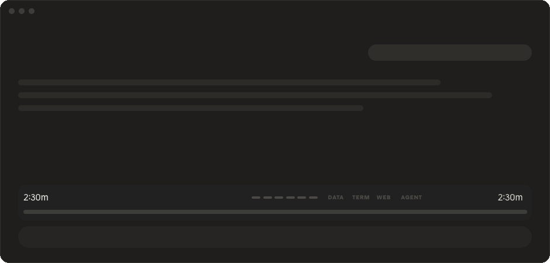

🇩🇪 [Deutsch](README.de.md)

# Pick your own sound for when Claude is done

**nix done-sound – your alert sound: get notified when Claude is done or waiting for you.**



## The problem

Claude works, you do something else – and miss when it's done or waiting for your answer. The Claude app does notify you, but only while it's in the background, and always with the same system sound.

## The solution

Your **own alert sound** plays when Claude finishes longer work (15 seconds or more) – and, if you like, a second one when Claude waits for you. **No sound is included:** right after installing, Claude asks you in the first chat which sound you want and sets it up for you.

## Install

1. Open Claude Code (desktop app or terminal).
2. Type this into the message box and press Enter:
   ```
   /plugin marketplace add nikscz/nix-done-sound
   ```
3. Then:
   ```
   /plugin install nix-done-sound@nix-done-sound
   ```
4. Restart Claude Code once (or type `/reload-plugins`). Done.

No GitHub account needed.

## How to

### Pick a sound – Mac

- **System sound:** `/nix-done-sound list` shows all sounds on your Mac (e.g. Glass, Hero, Pop,
  Purr, Submarine). Then, for example:
  ```
  /nix-done-sound Glass
  ```
- **Your own file** (mp3, wav, aiff, m4a): select the file in Finder, then **right-click → hold
  Option (⌥) → "Copy … as Pathname"**, and paste:
  ```
  /nix-done-sound /Users/yourname/Music/done.mp3
  ```

### Pick a sound – Windows

- **System sound:** `/nix-done-sound list` shows the sounds in `C:\Windows\Media`
  (e.g. chimes, notify, tada). Then, for example:
  ```
  /nix-done-sound tada
  ```
- **Your own file** (mp3, wav): select the file in Explorer, **right-click → "Copy as path"**
  (Windows 10: Shift + right-click), and paste:
  ```
  /nix-done-sound "C:\Users\yourname\Music\done.wav"
  ```

### All commands

| Command | What happens |
|---|---|
| `/nix-done-sound` | shows your current sound and the help |
| `/nix-done-sound list` | lists your system sounds |
| `/nix-done-sound Name` or `path` | sets the done sound (plays once as a preview) |
| `/nix-done-sound wait Tink` | optional: own sound when Claude waits for you |
| `/nix-done-sound off` / `on` | mute and unmute |

Your choice applies to all chats. German keywords work too (`liste`, `warten`, `aus`, `an`).
Sound playback on Windows is not tested much yet – feedback welcome.

## Privacy & security

Everything stays on your computer:

| Reads | Stores |
|---|---|
| The list of your system sounds, and the sound file you pick | the path to your sound, in Claude Code's plugin storage |
| When Claude is done, or shows you a permission prompt or a question | nothing – it just plays your sound |

**Sends nothing anywhere.** No internet connection, no tracking, no analytics. The code is open –
you can check it yourself.

**Language check:** so the labels show up in your language, it reads your system language once per chat
with one harmless system command – `defaults read -g AppleLanguages` on a Mac,
`(Get-Culture).TwoLetterISOLanguageName` in PowerShell on Windows. Nothing else is read.

> [!WARNING]
> **Early version – updates will come.** This kind of extension is still brand new in Claude Code.
> After an update from Anthropic something may stop working until a fix lands here.
> With automatic updates on (below) you get the fix by itself.

## Updates

Turn it on once and forget it: type `/plugin` → **Marketplaces** → **nix-done-sound** → turn on
automatic updates.

Or by hand, whenever you like:
```
/plugin marketplace update nix-done-sound
```

### What's new

**2.2 – German and English.** The tool's own labels now follow your system language: German
on a German system, English everywhere else. Other languages (e.g. Spanish) get the English labels –
but everything Claude writes itself (the steps, the thank-you, its answers) comes in your language
anyway.

## Uninstall

```
/plugin uninstall nix-done-sound@nix-done-sound
```

## More from nikscz

- [nix-checklist-sidebar](https://github.com/nikscz/nix-checklist-sidebar) – Claude's plan as a checklist
- [nix-progress-bar](https://github.com/nikscz/nix-progress-bar) – progress bar with a time estimate
- [nix-note](https://github.com/nikscz/nix-note) – project notes on the side with /note

## License

[MIT](LICENSE) – use it, change it, pass it on, no warranty.

Made with Claudius, for Claudius. Found a bug or have an idea?
Open an [issue](https://github.com/nikscz/nix-done-sound/issues).
